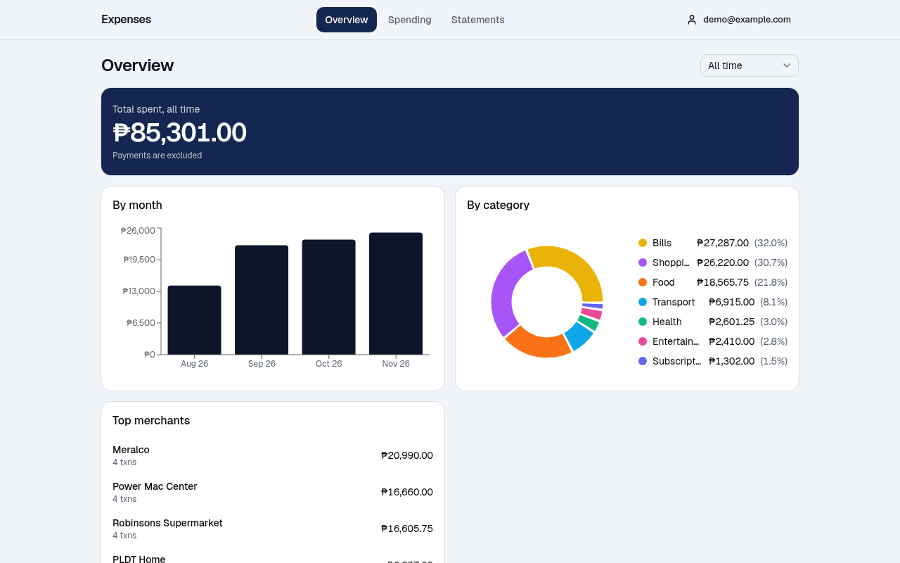
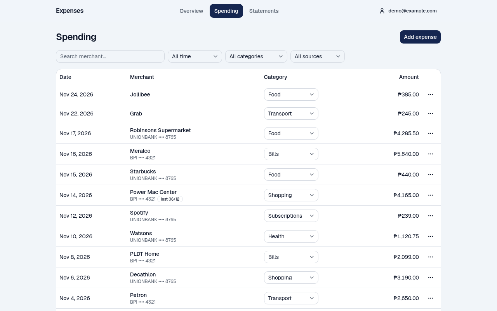
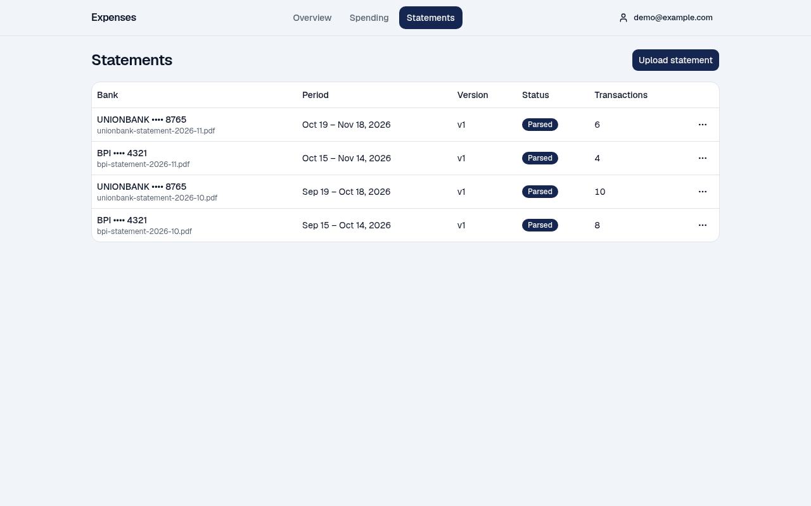

# Expense Tracker

A self-hosted personal expense tracker built with **Bun + Hono** (API & SQLite storage) and **React + Tailwind CSS** bundled with Bun. Import credit-card statement PDFs (BPI and UnionBank parsers, including password-protected PDFs) or record transactions manually. All amounts are stored in integer minor units (centavos, PHP).

## Features & Security

- **Local SQLite persistence** via `bun:sqlite` (`$DATA_DIR/app.db`, created with owner-only `0600` permissions inside `0700` `$DATA_DIR`).
- **Authentication & session hardening:** Argon2id password hashing, SHA-256 hashed session tokens in `HttpOnly` `SameSite=Lax` cookies, per-IP and per-account login rate limiting, optional `ALLOW_SIGNUP=0` lockdown, and CSP / `X-Frame-Options` / `X-Content-Type-Options` / conditional HSTS headers.
- **In-memory PDF statement import:** Supports BPI and UnionBank credit-card statements up to 15 MB and 50 pages without storing raw PDFs on disk, handles password-protected PDFs (`423`), deduplicates repeated uploads (`409`), and auto-categorizes transactions with customizable merchant rules.

## Screenshots

### Overview Dashboard
Monthly spending trend, category breakdown, and top merchants.



### Spending & Categorization
Searchable and filterable transaction list with inline category editing, merchant rules, and manual expense entry.



### Statement Imports
Uploaded BPI and UnionBank PDF statements with billing periods, parsing status, and re-categorization.



---

## Docker Deployment (Recommended)

Pre-built multi-architecture (`linux/amd64` and `linux/arm64`) **Bun Alpine** images are published to GitHub Container Registry at `ghcr.io/tunitz/expense-tracker`.

```bash
# Optional: copy .env.example to .env and adjust PORT / ALLOW_SIGNUP / COOKIE_SECURE
cp .env.example .env

# Start with the published GHCR image (persists SQLite data in the expense-data volume at /data)
docker compose up -d
```

Open http://localhost:3020. Check health at `GET /api/health` (`{"ok":true}`).

### Updating an Existing Deployment

```bash
docker compose pull
docker compose up -d
```

### Building Locally with Compose

```bash
docker compose -f compose.yaml -f compose.dev.yaml up -d --build
```

> **Maintainer note:** On the first publish to GHCR (or if the repository was previously private), ensure the `expense-tracker` package visibility under **GitHub Packages -> Package settings** is set to **Public** so `docker compose pull` works without authentication.

---

## Quick Start (Local Bun)

Requires [Bun](https://bun.sh/) (`1.4+`).

```bash
bun install --frozen-lockfile
bun run dev
```

Open http://localhost:3000 (the Bun web dev server proxies `/api` to the API server on port `3020` by default).

### Production Mode with Bun

```bash
bun install --frozen-lockfile
bun run build
bun run start
```

Open http://localhost:3020. Bun serves both the built UI (`web/dist`) and the API.

Both `bun run dev` and `bun run start` compile the optional Rust CP037 statement decoder via Cargo (Rust 1.97+). For a pure Bun setup without Cargo, run either command with `EXPENSE_CP037_MODE=js`:

```bash
EXPENSE_CP037_MODE=js bun run dev
```

---

## Configuration

See [`.env.example`](.env.example) for a ready-to-copy template.

| Variable | Default | Description |
| --- | --- | --- |
| `PORT` | `3020` | API listen port (and host port in `compose.yaml`) |
| `WEB_PORT` | `3000` | Web dev server listen port (`bun run dev`) |
| `DATA_DIR` | `./data` | Directory for `app.db` (`/data` inside Docker) |
| `WEB_DIR` | `./web/dist` | Static web assets directory (`/app/web/dist` inside Docker) |
| `ALLOW_SIGNUP` | `1` | Set to `0` to disable `POST /api/auth/register` |
| `COOKIE_SECURE` | `0` | Set to `1` behind HTTPS to set `Secure` cookies and emit `Strict-Transport-Security` |
| `TRUST_PROXY` | `0` | Set to `1` behind a trusted reverse proxy so `X-Forwarded-For` is used for rate limiting |
| `EXPENSE_CP037_MODE` | *(unset)* | Set to `js` to use the TypeScript CP037 decoder instead of the Rust N-API addon (default in Docker) |
| `IMAGE_TAG` | `latest` | Container image tag pulled by `compose.yaml` (e.g. `latest`, `0.1.0`, `0.1`) |

## Production Hardening & Backups

1. **Register your account first, then lock registration:** Start the stack, register your user, and restart with `ALLOW_SIGNUP=0`.
2. **Terminate TLS at a reverse proxy:** Run behind HTTPS (Caddy, Nginx, Traefik, Cloudflare Tunnel) and set `COOKIE_SECURE=1` and `TRUST_PROXY=1`.
3. **Back up the SQLite database:** Persist `/data` (`expense-data` volume) and take consistent backups with `sqlite3 /data/app.db ".backup '/backup/app.db'"`.

---

## API Routes

### Health
- `GET /api/health` — Returns `{"ok":true}`

### Auth
- `POST /api/auth/register` — Register user (`{email, password}`), sets `sid` cookie (`201`, or `403` when `ALLOW_SIGNUP=0`)
- `POST /api/auth/login` — Log in (`{email, password}`), sets `sid` cookie (`200`)
- `POST /api/auth/logout` — Revoke session and clear `sid` cookie (`204`)
- `GET /api/me` — Return `{id, email}` for the authenticated user (`401` if unauthenticated)

### Transactions & Categories (Authenticated)
- `GET /api/private/transactions` — List transactions (`from`, `to`, `accountId`, `categoryId`, `q`, `kind`, `source`, `limit`, `offset`)
- `GET /api/private/transactions/summary` — Spend totals by category, month, and top merchants (`from`, `to`, `accountId`)
- `POST /api/private/transactions` — Create a manual transaction
- `PATCH /api/private/transactions/:id` — Update category (with optional `applyToMerchant` and `saveRule`), notes, payment method, or manual transaction fields
- `DELETE /api/private/transactions/:id` — Hard-delete manual rows or soft-delete imported PDF rows (`204`)
- `GET /api/private/transactions/categories` — List user categories
- `POST /api/private/transactions/categories` — Create a category (`201`)
- `DELETE /api/private/transactions/categories/:id` — Delete a category (`204`)

### Documents (Authenticated)
- `POST /api/private/documents` — Upload statement PDF (`multipart/form-data`: `file` + optional `password`)
- `GET /api/private/documents` — List uploaded statements and transaction counts
- `POST /api/private/documents/:id/recategorize` — Re-apply default categories and merchant rules to uncategorized transactions for a statement
- `DELETE /api/private/documents/:id` — Delete statement and its imported PDF transactions (`204`)

## Statement Import Notes

- **Supported banks:** BPI and UnionBank credit-card statement PDFs.
- **Limits:** Maximum file size `15 MB`; maximum `50` pages.
- **Encrypted PDFs:** Missing or wrong password returns HTTP `423` with `{error: "password_required", wrong: boolean}`.
- **Duplicate files:** Re-uploading an identical file (matching SHA-256) returns HTTP `409` with `{error: "already_uploaded"}`.

---

## Project Layout

- `src/server/` — Bun + Hono API server, SQLite schema/migrations, auth, categorization, routes, and bank parsers
- `web/` — React frontend and Bun build/dev scripts (`web/build.ts`, `web/dev.ts`)
- `rust/statement-cp037/` — Optional native Rust N-API CP037 decoder (see [rust/statement-cp037/README.md](rust/statement-cp037/README.md))
- `scripts/` — Dev runner, native build helper, and synthetic statement profiler
- `docs/screenshots/` — Application UI screenshots for documentation
- `Dockerfile` — Multi-stage `oven/bun:1-alpine` production image definition
- `compose.yaml` — Production Compose configuration (GHCR image)
- `compose.dev.yaml` — Local source build Compose override
- `.github/workflows/` — Pull request CI (`ci.yml`) and automated SemVer release + GHCR publish (`release.yml`)
- `AGENTS.md` / `CLAUDE.md` — Contributor & AI agent workflow guidelines

---

## Testing, Build & Profiling

```bash
# Run tests (works without private fixtures; sets JS decoder mode)
EXPENSE_CP037_MODE=js bun test

# Run tests with local native addon (if built)
bun test

# Typecheck server and web app
bun run typecheck

# Lint the web app
bun run lint

# Build the web app (outputs web/dist)
bun run build

# Benchmark synthetic 20-page statement extraction & parsing (300 iterations)
bun scripts/profile-statements.ts 300 20
```

## Contributing & Releases

See [AGENTS.md](AGENTS.md). All changes must be made on a `feature/<branch>` branch and merged via Pull Request into `main`. Direct commits or pushes to `main` are prohibited.

This project uses **Conventional Commits** for automatic SemVer releases on merge to `main`:
- `fix:` / `docs:` / `chore:` / `refactor:` -> **patch** release
- `feat:` -> **minor** release
- `feat!:` / `fix!:` / `BREAKING CHANGE:` -> **major** release

## License

[MIT](LICENSE)
